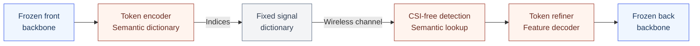

<div align="center">

<h2>D²SS: Dual-Dictionary Semantic Signaling for Robust Task-Oriented Wireless Communication in Split-Computing System</h2>

**Keep the backbone. Learn the wireless interface.**


[Quick start](#quick-start) · [Models & results](#models-results) · [Training details](#training-details)

</div>

D²SS enables wireless split inference with **frozen pretrained models**. Two dictionaries share the same indices: one represents task-relevant semantics, and the other determines transmitted waveforms.

- 🔒 **Reuse pretrained backbones** — ResNet18, DiracNet18V2, and MobileNetV1 ×0.5.
- 📡 **Receive without CSI** — detect semantic indices through correlation energy.
- 🧩 **Train without a target channel model** — combine reliability-guided refinement with dictionary-subspace augmentation.

## 🧠 How it works



<a id="quick-start"></a>
## 🚀 Quick start

### 1. Install

Use **Python 3.11** and **PyTorch ≥2.3** with a matching torchvision build. Install PyTorch for your CUDA platform using the [official selector](https://pytorch.org/get-started/locally/), then:

```bash
python -m pip install -r requirements.txt
```

CUDA is selected automatically when available; otherwise the scripts use CPU.

### 2. Prepare data

Use ImageNet-100 in `ImageFolder` format, with the same 100 class names as the checkpoints:

```text
ImageNet-100/
├── train/<class-name>/*.JPEG
└── val/<class-name>/*.JPEG
```

Images are cropped to **224 × 224** and normalized with ImageNet statistics. Evaluation requires only `val/`. Replace `/path/to/ImageNet-100` in the commands below with your dataset path.

<details>
<summary>🔎 Inspect the checkpoint's class list</summary>

```bash
python -c "import torch; c = torch.load('weights/resnet18/best.pt', map_location='cpu', weights_only=False); print('\n'.join(c['classes']))"
```

</details>

### 3. Evaluate a released model

```bash
python test.py --checkpoint runs/resnet18/full/best.pt --data-root /path/to/ImageNet-100 --out runs/resnet18/eval_csi_free --modes none
```

This evaluates **AWGN, Rician (`K_R = 5`), and Rayleigh** at SNRs `[-9, -7, -5, -3, -1, 1, 5, 9]` dB, with **five repeats**. Results are saved as `results_summary.csv` and `top1_table.csv` in the output directory.

For a quick check, append `--snrs -9 9 --repeats 1`. The checkpoint supplies the model and configuration.

### 4. Train your own model

```bash
python train.py --backbone resnet18 --weights weights/resnet18/best.pt --data-root /path/to/ImageNet-100 --out runs/resnet18/reproduce
```

Use a new output directory to preserve the released experiments. Training automatically evaluates both `best.pt` and `last.pt`; add `--no-final-test` to defer evaluation.

<a id="models-results"></a>
## 📦 Models & results

**ImageNet-100 · Rayleigh fading · CSI-free top-1 accuracy (%)**

Results use `N = 8`, `M = 196`, and five evaluation repeats over 5,000 validation images.

| Backbone | Backbone weights | D²SS checkpoint | −9 dB | 9 dB |
| --- | :---: | :---: | ---: | ---: |
| ResNet18 | [Weights](weights/resnet18/best.pt) | [Checkpoint](runs/resnet18/full/best.pt) | **69.04** | 78.33 |
| DiracNet18V2 | [Weights](weights/diracnet18v2/best.pt) | [Checkpoint](runs/diracnet18v2/full/best.pt) | **66.56** | 75.57 |
| MobileNetV1 ×0.5 | [Weights](weights/mobilenet_wd2/best.pt) | [Checkpoint](runs/mobilenet_wd2/full/best.pt) | **63.62** | 72.30 |

📊 Full SNR tables: [ResNet18](runs/resnet18/full/test_best/top1_table.csv) · [DiracNet18V2](runs/diracnet18v2/full/test_best/top1_table.csv) · [MobileNetV1](runs/mobilenet_wd2/full/test_best/top1_table.csv)

`weights/` contains the **pretrained backbones** used to start training. `runs/` contains the **trained D²SS systems**, logs, results, and checkpoints.

<details>
<summary>🔁 Train the other two backbones</summary>

```bash
python train.py --backbone diracnet18v2 --weights weights/diracnet18v2/best.pt --data-root /path/to/ImageNet-100 --out runs/diracnet18v2/reproduce
python train.py --backbone mobilenet_wd2 --weights weights/mobilenet_wd2/best.pt --data-root /path/to/ImageNet-100 --out runs/mobilenet_wd2/reproduce
```

</details>

<a id="training-details"></a>
## ⚙️ Training details

<details>
<summary>Default configuration and saved outputs</summary>

Defaults are defined in [`config.yaml`](config.yaml).

| Setting | Default |
| --- | --- |
| Tokens / dimension / dictionary size | `N = 8` / `D = 256` / `K = 128` |
| Signal dimension / complex channel uses | `M = 196` / `N × M = 1568` |
| Stage I | 25 continuous warmup + 50 quantized epochs |
| Stage II | 125 dictionary-subspace augmentation epochs |
| Optimizer | AdamW + cosine scheduling |
| Learning rates / batch size | `3e-4` → `1e-4` / `256` |
| Training seed / signal-dictionary seed | `42` / `42` |

`best.pt` is selected by **augmented validation accuracy**, not test-channel accuracy. Stage II starts from the best quantized Stage I checkpoint.

Each run saves `train.log`, `settings.json`, `metrics.csv`, and model checkpoints. Automatic evaluations are stored in `test_best/` and `test_last/`.

</details>

<details>
<summary>▶️ Resume training and adjust settings</summary>

```bash
python train.py --backbone resnet18 --data-root /path/to/ImageNet-100 --out runs/resnet18/reproduce --resume runs/resnet18/reproduce/last.pt
```

Resume with the original configuration and overrides; keep `stage1_best.pt` in the same output directory. Backbone weights are already stored in the training checkpoint.

Use `--m 64` to change the signal dimension, or `--batch-size 64 --workers 0` to adjust data loading. Start a new run when changing the training configuration. See `python train.py --help` and `python test.py --help` for all options.

</details>

## 📖 Paper

**D²SS: Dual-Dictionary Semantic Signaling for Robust Task-Oriented Wireless Communication in Split-Computing System** is submited to IEEE.

If you use this code, please cite the accompanying paper. Backbones are provided by `pytorchcv`; the semantic dictionary follows the [SimVQ parameterization](https://doi.org/10.1109/ICCV51701.2025.02132).

